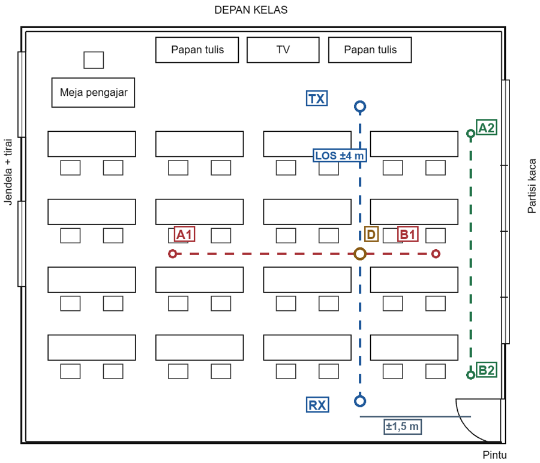

# Proposal Minggu 1: Case A, Deteksi Kehadiran dan Gerakan dengan CSI

**Mata kuliah:** Jaringan Nirkabel · **Perangkat:** HackRF One (receive-only), hotspot HP, laptop Python 3 · **Lokasi:** kelas F4.12 FILKOM UB

## 1. Case yang dipilih dan alasannya

Case A (Dasar, 20 paket/s, 2.4 atau 5 GHz). Alasan:

- **Risiko teknis rendah dan sudah terbukti:** rekaman uji kanal 6 memberi 3216 paket CSI rho > 0.6 dalam 10 s, penting karena minggu 1–2 dipadatkan ke 6 hari.
- **Langsung membandingkan CSI dengan RSSI**, sesuai rubrik, dan dapat dijawab dengan angka (akurasi, FPR, FNR).
- **Tidak butuh banyak subjek atau pengulangan per subjek**, sehingga waktu cukup untuk eksplorasi yang terukur.

## 2. Pertanyaan riset dan hipotesis

**Pertanyaan:** apakah CSI dapat membedakan ruang kosong, orang diam, dan orang bergerak lebih baik daripada RSSI?
Fitur per jendela 1 s: `csi_var_norm` = rata-rata 52 subcarrier dari var(|H[k]|)/mean(|H[k]|)²; pembanding `rssi_var` = variansi RSSI paket yang sama.

- **H1.** Detektor ambang `csi_var_norm` mencapai akurasi ≥ 90% dan FPR ≤ 10% untuk *kosong vs bergerak* (jalan_los + jalan_luar_los) pada leave-one-session-out. *Terbantah jika* akurasi rata-rata < 90% atau FPR > 10%.
- **H2.** Pada data uji yang sama, akurasi detektor `rssi_var` paling sedikit 10 poin persentase di bawah detektor CSI, terutama untuk berjalan di luar LOS. *Terbantah jika* selisihnya < 10 poin.
- **H3.** Median `csi_var_norm` *duduk diam di LOS* lebih besar daripada *kosong* (Mann-Whitney satu sisi, p < 0.05), walaupun lebih kecil dari skenario berjalan. *Terbantah jika* p ≥ 0.05.

## 3. Desain eksperimen

<b>Gambar 1.</b> Denah kelas F4.12. <b>TX</b> hotspot HP di ujung depan lorong antarblok meja, <b>RX</b> HackRF + laptop di ujung belakang lorong yang sama; LOS ±4 m, tinggi alat ±1 m. <b>D</b> titik duduk di tengah LOS. <b>L1</b> (A1↔B1) memotong LOS di sela baris meja 2 dan 3. <b>L2</b> (A2↔B2) sejajar LOS di lorong sisi kaca, ±1,5 m dari LOS. Semua titik ditandai lakban dan difoto.

| Item | Rencana |
|---|---|
| Skenario | `kosong` (baseline), `duduk_los` (D), `jalan_los` (L1 bolak-balik), `jalan_luar_los` (L2 bolak-balik) |
| Sesi | 4 skenario × 3 sesi, masing-masing ≥ 30 s (minimal case base). Putaran 1 sudah direkam: 12 sesi, 28–31 s |
| Subjek | Putaran 1: P1 untuk semua sesi; bila waktu cukup, putaran 2 dengan P2 dan P3. Kode anonim, persetujuan tertulis |
| Kanal | **2.4 GHz kanal 6 (2437 MHz)**, hotspot 802.11n; frame OFDM terbukti memberi CSI (rho > 0.6). Cadangan: 5 GHz kanal 36 |
| Gain | `-l 40 -g 26 -a 0`, dikunci dan dicatat di `log_sesi.csv`. Daya L-LTF umumnya −1 sampai 0 dBFS (dekat batas ADC 8-bit): sebelum rekaman lanjutan, clipping di `cek_rekaman.py` harus < 0.01%, bila tidak laptop dijauhkan atau gain diturunkan (`-l 32`) |
| Pemancar | Hotspot Xiaomi 13T milik kelompok, kanal dikunci. Trafik: `ping -i 0.01` (WSL) atau `kode/trafik.py` (Windows). Paket HP dipisah dari paket laptop dengan RSSI (selisih ±12 dB) dan durasi burst; CFO keduanya sama (sekitar −9 kHz) sehingga tidak dipakai |
| Laju paket | Butuh 20 paket/s, target ≥ 50. Terukur: ping **92.4 paket/s** (interval 10 ms, 0% loss); rekaman uji ±103 paket CSI/s setelah filter; sesi putaran 1: 120–214 paket/s, celah terpanjang 0.9–1.9 s, jadi jendela < 5 paket dibuang (95.8% jendela tetap terpakai) |
| Kontrol | Tidak ada orang lain saat baseline, pintu tertutup, kondisi dan jam mulai dicatat di `log_sesi.csv` |

## 4. Metrik keberhasilan

| Metrik | Target |
|---|---|
| Akurasi detektor CSI kosong vs bergerak, pada data uji yang tidak dipakai menentukan ambang | ≥ 90% |
| False positive rate / false negative rate | ≤ 10% / ≤ 10% |
| Selisih akurasi CSI − RSSI pada data uji yang sama | ≥ 10 poin persentase |
| Rasio median fitur bergerak/kosong | rasio `csi_var_norm` > rasio `rssi_var` |
| Kualitas data per sesi | ≥ 20 paket/s setelah filter, ≥ 90% jendela berisi ≥ 5 paket, clipping < 0.01% |

## 5. Skema pembagian data latih dan uji

Leave-one-session-out: ambang (CSI dan RSSI, cara yang sama) dipilih hanya dari 2 sesi dengan memaksimalkan balanced accuracy, diuji di sesi ke-3, diulang 3 kali, dilaporkan rata-rata ± simpangan baku. Jendela satu sesi tidak pernah dipecah ke latih dan uji. Jika data P2 dan P3 tersedia, ditambah leave-one-person-out.

## 6. Gagasan eksplorasi

**Batas laju paket untuk beacon AP.** Data hotspot ditipiskan ke grid teratur 50, 20, 10, 5 paket/s (`eksplorasi_laju.py`) lalu detektor dievaluasi ulang dengan leave-one-session-out, dibandingkan dengan laju beacon AP (±9.77 paket/s). *Hipotesis:* akurasi tetap ≥ 90% pada 10 paket/s. *Terbantah jika* < 90%. Cadangan: menghitung orang (0–3 orang bergerak), apakah fitur CSI naik monoton (korelasi Spearman, `hitung_orang.py`).

## 7. Tanggapan atas kritik kelompok lain

| Kritik/saran | Tanggapan dan bagian yang diubah |
|---|---|
| **[ISI kritik 1]** | |
| **[ISI kritik 2]** | |
| **[ISI saran]** | |

## 8. Pembagian tugas anggota

Rincian di `docs/pembagian_tugas.md`. Semua anggota bergantian menjadi subjek atau pengawas.

| Tim | Anggota | Tugas utama |
|---|---|---|
| Rekam dan Hardware | Bagas, Yoga, Marvin, Farhan | HackRF, hotspot, laju paket, pemisahan pemancar, sesi rekaman, log |
| Pipeline CSI | Faruqi, Zaid, Dinda, Priyambodo | ekstraksi dan validasi CSI, resampling, README, demo |
| Analisis dan Eksplorasi | Micheline, Nafis, Giri, Taqiya | desain eksperimen, heatmap, fitur, detektor, eksplorasi |
| Dokumen dan Presentasi | Putri, Mayu, Rajwa, Faris | proposal, kritik silang, persetujuan subjek, laporan, slide |
